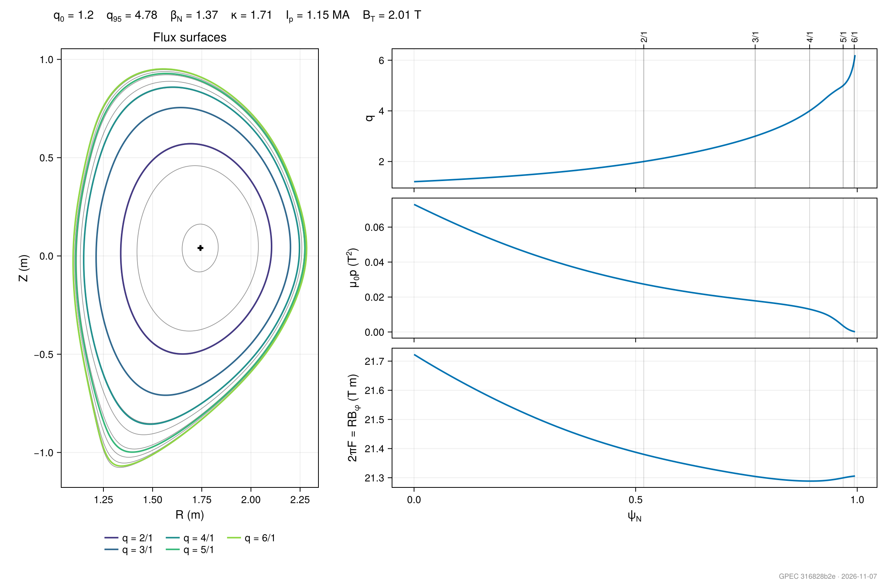
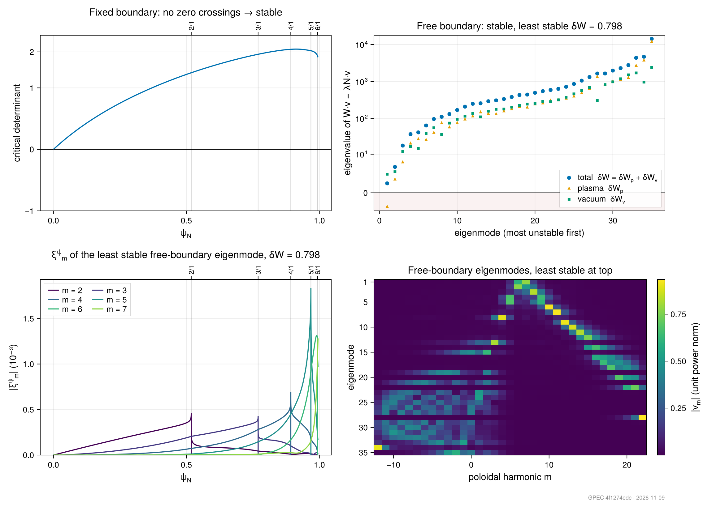
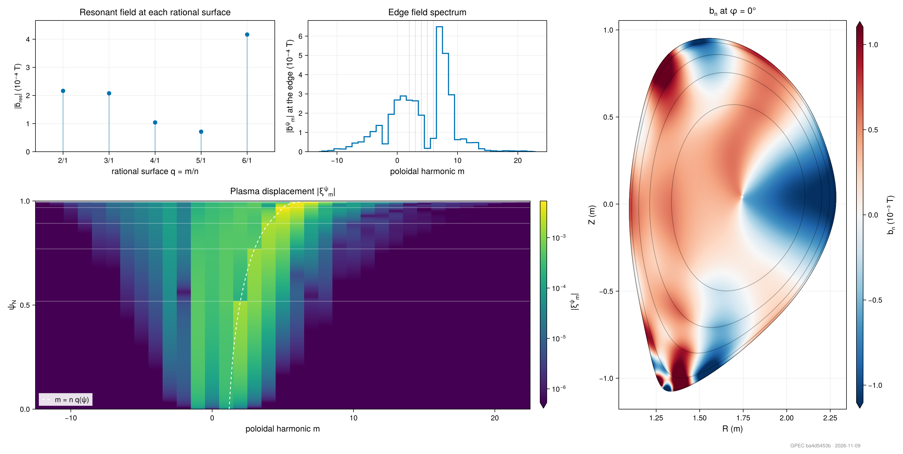
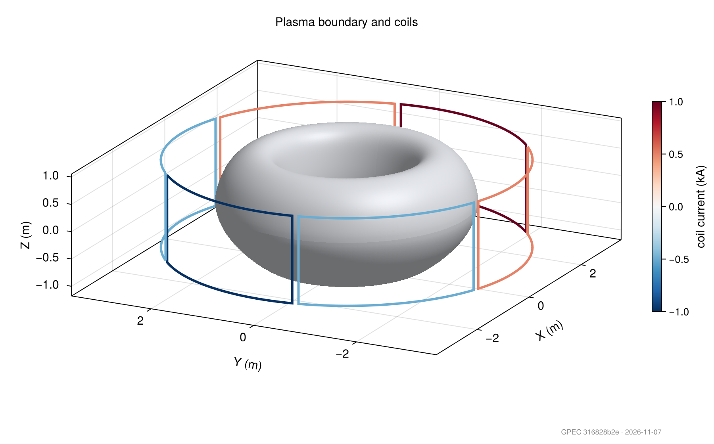

# Analysis

`Analysis` holds the plotting and post-processing functions for GPEC results, grouped by the stage they read. Each registered plot takes the in-memory result or the path of the `gpec.h5` it was saved to; `available_plots` lists them with what each source can draw (see [Plotting a result](api.md#Plotting-a-result)).

## Submodules

- `ForceFreeStates`: the eigenmode energies, the `crit` scan and the displacement profiles of a stability solve
- `Equilibrium`: flux surfaces, profiles and the radial grid of an equilibrium
- `CoilForcing`: coil geometry and the normal-field spectra it drives
- `PerturbedEquilibrium`: the plasma response, the resonant fields, island widths and Chirikov parameter against ψ_N or q
- `PerturbedEquilibriumModes`: helpers that convert the modal output to (ψ, θ) and (ψ, θ, φ) grids for real-space plots
- `ErrorFields`: coil sensitivities, tolerance distributions, locking risk and correction limits (see [Error Fields](error_fields.md))

`examples/DIIID-like_ideal_example/analyze_example.jl`, `examples/Solovev_ideal_example/analyze_example.jl` and `examples/DIIID-like_error_field_example/analyze_example.jl` are worked examples of each; the s–α maps of local stability use `salpha_reference`, `compute_ballooning_stability!` and `scan_delta_prime_map`.
`write_imas` on the [Utilities](utilities.md) page exports results to an IMAS data dictionary.

## Drawing

The plots are drawn with [Makie](https://docs.makie.org), which GPEC loads only when a session loads a Makie backend. Load one alongside GPEC, from your own or the global environment:

```julia
using GeneralizedPerturbedEquilibrium, CairoMakie   # files: PNG, PDF, SVG
using GeneralizedPerturbedEquilibrium, GLMakie      # interactive windows that zoom, pan and rotate
```

Every plot returns a Makie `Figure`, and `save_path` saves it with the loaded backend (GLMakie writes PNG only). Without a backend a plot throws an `ArgumentError` saying which to load.

The summary figures of a DIII-D-like run (`examples/DIIID-like_ideal_example`):









```@docs
GeneralizedPerturbedEquilibrium.Analysis
```

## Plot registry

```@autodocs
Modules = [GeneralizedPerturbedEquilibrium.Analysis]
Pages = ["Registry.jl"]
```

## ForceFreeStates

```@autodocs
Modules = [GeneralizedPerturbedEquilibrium.Analysis.ForceFreeStates]
```

## Equilibrium

```@autodocs
Modules = [GeneralizedPerturbedEquilibrium.Analysis.Equilibrium]
```

## CoilForcing

```@autodocs
Modules = [GeneralizedPerturbedEquilibrium.Analysis.CoilForcing]
```

## PerturbedEquilibrium

```@autodocs
Modules = [GeneralizedPerturbedEquilibrium.Analysis.PerturbedEquilibrium]
```

## PerturbedEquilibriumModes

```@autodocs
Modules = [GeneralizedPerturbedEquilibrium.Analysis.PerturbedEquilibriumModes]
```

## ErrorFields

```@autodocs
Modules = [GeneralizedPerturbedEquilibrium.Analysis.ErrorFields]
```
