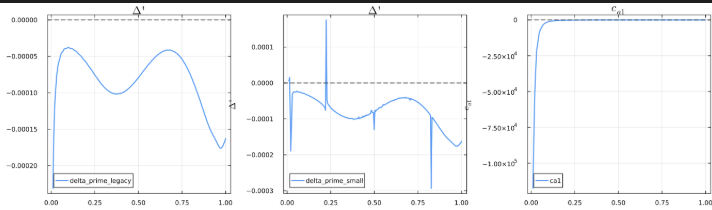

# Local Stability

`LocalStability` evaluates the local, high-``n`` ideal and resistive criteria on every flux surface of the equilibrium: the Mercier interchange index ``D_I``, the Glasser–Greene–Johnson resistive-interchange index ``D_R`` and the ballooning stability index, with an optional scan for the critical pressure gradient.
It runs as its own stage, after `ForceFreeStates` and on the same equilibrium, and is the local counterpart of the global analysis on the [Stability](stability.md) page.

## What it computes

- **Mercier criterion** ``D_I``: the ideal interchange index of each surface. A surface is Mercier unstable where ``D_I > 0``; the same number sets the exponents ``-1/2 \pm \sqrt{-D_I}`` of the large and small solutions that the global integration matches at every rational surface.
- **Resistive interchange** ``D_R = D_I + (H - 1/2)^2``, with ``H`` from the flux-surface averages of [Glasser, Greene and Johnson (1975)](citations.md#LocalStability). ``D_R > 0`` indicates resistive interchange instability.
- **Ballooning stability** ``\Delta'``: the high-``n`` ballooning index, obtained by integrating the marginal ballooning equation along the field line and matching the solution to its asymptotic forms at both ends ([Connor, Hastie and Taylor (1978)](citations.md#LocalStability)). It is distinct from the tearing Δ′ of `SingularSurfaces/`; ``\Delta' = 0`` is the marginal ballooning boundary.
- **Critical pressure gradient**: with `alpha_boundary_scan = true` the pressure gradient of each surface is scaled until the ballooning boundary is reached, giving the normalized gradient ``\alpha`` and its critical value ``\alpha_\mathrm{crit}``, the s–α diagram collapsed to a profile.

## Governing equations

Ballooning modes have long wavelength along the field and short wavelength across it.
A perturbation ``\varphi`` periodic in the poloidal angle ``\theta`` and the Clebsch angle ``\beta = \zeta - q\theta + \int q' \theta_0\, d\psi`` is represented on the covering space ``-\infty < \theta < \infty``,

```math
\varphi(\psi, \theta, \beta) = \sum_{l=-\infty}^{\infty} \hat{\varphi}(\psi, \theta - l)\, \exp[-2\pi i n(\beta + lq)],
```

so that the secular growth of the perpendicular wave number with the shear ``q'`` enters through ``|\nabla\beta|^2``.
At marginal stability the ideal energy principle gives the ballooning equation along the field line,

```math
\mathbf{B}\cdot\nabla\left(\frac{|\nabla\beta|^2}{B^2}\, \mathbf{B}\cdot\nabla\hat{\varphi}\right) + 2\frac{P'}{\chi'}\kappa_w \hat{\varphi} = 0 ,
```

with ``\chi`` the poloidal flux, ``P'`` the pressure gradient and the projected curvature

```math
\kappa_w \equiv \frac{\boldsymbol{\kappa}\times\mathbf{B}}{B^2}\cdot\nabla\beta = \kappa_n - q'\theta\,\kappa_s ,
\qquad
\kappa_s = \frac{\boldsymbol{\kappa}\times\mathbf{B}}{B^2}\cdot\nabla\psi = -\frac{\pi f}{\mathcal{J}}\frac{\partial}{\partial\theta}\left(\frac{1}{B^2}\right),
```

split into its non-secular part ``\kappa_n`` and the secular part driven by the shear.
The code integrates it as the first-order system ``\partial_\theta \mathbf{u} = \mathbf{L}\mathbf{u}`` in ``\mathbf{u} = (\hat{\varphi},\ |\nabla\beta|^2 \chi' \partial_\theta\hat{\varphi}/(B^2\mathcal{J}))``.

As ``\theta \to \infty`` the coefficients diverge like ``q'^2\theta^2|\nabla\psi|^2``.
The canonical transformation ``\mathbf{R} = \operatorname{diag}(\theta^{-1/2}, \theta^{1/2})`` followed by a shear ``\mathbf{S}`` with ``\sigma = -2\pi f P' q'/(\chi'^2 B^2)`` makes the leading-order matrix ``\mathbf{N}_0`` finite, and the period average of that matrix fixes the asymptotic exponent:

```math
\det[\langle\mathbf{N}_0\rangle - \alpha\mathbf{I}] = 0, \qquad \alpha = \pm\sqrt{-D_I} .
```

This is the Mercier index: ``D_I = -\alpha^2`` evaluated from ``\langle\mathbf{N}_0\rangle`` equals the classical surface-average Mercier expression, and ``D_I > 0`` (complex exponents) is interchange instability.
The large and small solutions behave as ``\theta^{\alpha - 1/2}`` and ``\theta^{-\alpha - 1/2}``; the boundary condition at the finite integration limit ``\theta_\max`` includes the first-order correction of the asymptotic series, and the ballooning index is the jump in the logarithmic derivative of the solution between the two ends.

The s–α diagram scans the local stability of one surface without recomputing the equilibrium: a thin-layer ordering promotes local perturbations of the pressure gradient ``P'_s`` and shear ``q'_s`` to order unity in the derivatives, and the integrated shear ``I_\mathrm{tot} = q'(\theta - \theta_k) + I_\mathrm{per}`` carries them into ``|\nabla\beta|^2`` and ``\kappa_w``.
The cross term and the quadratic term in the perturbed shear are kept in the matrix assembly, and the ballooning angle ``\theta_k`` is the gauge where the total accumulated shear vanishes, ``I_\mathrm{tot}(\theta_k) = 0``.

## Running it

A `[LocalStability]` section runs the stage; it needs `[ForceFreeStates]` in the same deck.
Its keys are the problem settings, and the optional `[Ballooning]` section holds the [`Ballooning`](@ref) numerical settings, as in `examples/DIIID-like_ideal_example/gpec.toml`:

```toml
[LocalStability]
theta_k = 0.0                # ballooning angle
alpha_boundary_scan = true   # also find the critical alpha of each surface

[Ballooning]
ode_tol = 1e-8
n_scan = 24                  # alpha scan points
max_alpha_scale = 8.0
alpha_tol = 1e-3
psi_window = [0.1, 0.99]     # surfaces scanned for the alpha boundary
```

A script runs the same stage with `solve(LocalStabilityProblem(eq; theta_k=0.0, alpha_boundary_scan=true), Ballooning(); verbose=false)`; see the [Scripting API](api.md).
`examples/DIIID-like_ideal_example/analyze_example.jl` plots the ``s`` and ``\alpha`` profiles, the ``D_I`` and ballooning ``\Delta'`` profiles, and the two-dimensional s–α maps with their zero contours, using `salpha_reference`, `compute_ballooning_stability!` and `scan_delta_prime_map`.

## Outputs

| Dataset | Meaning |
|---|---|
| `LocalStability/psi` | the flux surfaces, ψ_N |
| `LocalStability/D_I` | Mercier index; ``D_I > 0`` is interchange unstable |
| `LocalStability/D_R` | resistive interchange index; ``D_R > 0`` is unstable |
| `LocalStability/ballooning_Delta_prime` | ballooning stability index along `psi`; ``\Delta' = 0`` is marginal |
| `LocalStability/ballooning_psi`, `alpha`, `alpha_critical` | with `alpha_boundary_scan = true`: the scanned surfaces, their normalized pressure gradient and its critical value |

`SingularSurfaces/D_I` repeats the Mercier index at the rational surfaces of the global solve.

## Numerical notes

- The non-secular curvature ``\kappa_n`` is evaluated from the geometric expression in ``\mathcal{J}B`` and its ``\psi`` and ``\theta`` derivatives rather than from Grad–Shafranov identities, which amplify equilibrium errors near the edge.
- Background quantities are differentiated once, in a first loop; the s–α perturbations are then added algebraically, so noisy geometric derivatives are never repeated.
- The integration limit is set where the quadratic term of the wave-number factor dominates, ``\theta_\max = \min(16.5,\ 10\max_\theta\sqrt{|c/a_2|})``, and the ballooning index is taken from a solution forced to vanish at ``\pm\theta_\max`` rather than from the coefficient of the small solution, which is numerically fragile:



- The periodic shear functions are shifted to vanish at ``\theta_k`` so the gauge ``I_\mathrm{tot}(\theta_k) = 0`` holds exactly.

## API reference

```@autodocs
Modules = [GeneralizedPerturbedEquilibrium.LocalStability]
```
