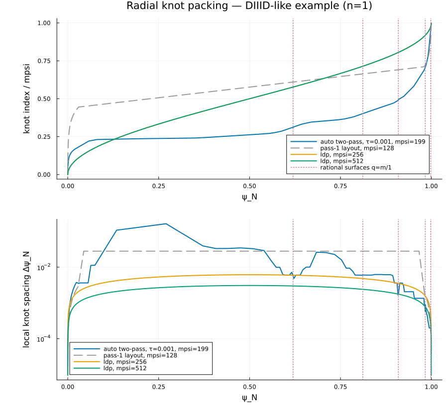

# Equilibrium

`Equilibrium` reads or constructs the axisymmetric MHD equilibrium, maps it to the straight-field-line coordinates every later stage works in, and returns a `PlasmaEquilibrium` holding the flux-surface splines, the profiles and the global parameters of the plasma.
It is the first stage of every run and the only one that reads physics input files: the equilibrium itself and, optionally, the kinetic profiles.

## What it computes

From the poloidal flux ``\psi(R, Z)`` and the profiles ``F = R B_\phi`` and ``p`` of a Grad–Shafranov solution, the module traces the closed flux surfaces, finds the magnetic axis and the separatrix, integrates the safety factor ``q(\psi)`` and the surface quantities ``dV/d\psi``, and builds bicubic splines of the surface geometry ``R(\psi, \theta)``, ``Z(\psi, \theta)`` and of the toroidal-angle offset ``\nu(\psi, \theta)`` in the coordinates selected by `jac_type` (`"hamada"`, `"pest"`, `"boozer"`, `"equal_arc"`, …; see the [Conventions Reference](conventions.md) page).
The normalized flux ``\psi_N \in [0, 1]`` runs from the axis to the boundary, and the rational surfaces q = m/n of the run are located on it.

## Inputs

`[Equilibrium] eq_type` selects the file format of `eq_filename`:

| `eq_type` | Format | Notes |
|---|---|---|
| `"efit"` | EFIT g-file | flux surfaces traced by a field-line ODE in the geometric angle; the default |
| `"efit_arclength"` | EFIT g-file | the same traced in arc length, which stays regular near the separatrix and reaches higher `psihigh` |
| `"efit_by_inversion"` | EFIT g-file | level sets traced by marching squares and fed to the inverse solver; the most accurate geometry |
| `"chease"` (`"chease_binary"`) | CHEASE binary output | inverse solver |
| `"chease2"` (`"chease_ascii"`) | CHEASE ASCII output | inverse solver |
| `"ifile"` | inverse i-file, as TokaMaker writes | inverse solver |
| `"imas"` | an `IMASdd.dd` passed from a script | `PlasmaEquilibrium(dd; kwargs...)`; see `examples/DIIID-like_ideal_example_IMAS` |

An analytic equilibrium is selected by its own section instead of `eq_type`: `[Solovev]` (the Solov'ev solution), `[LargeAspectRatio]` (a large-aspect-ratio model with prescribed profiles) or `[TJAnalytic]` (the profile family of Fitzpatrick's TJ code, `solver = "inverse" | "direct"`); their keys are the fields of `SolovevConfig`, `LargeAspectRatioConfig` and `TJAnalyticConfig`.

### Kinetic profiles

`[Equilibrium] kinetic_file` attaches the density, temperature, rotation and transport profiles that the kinetic solve, [Kinetic Forces](kinetic_forces.md) and the `SLAYER` layer of [Tearing](inner_layer.md) read, so every kinetic consumer sees one plasma.
Two formats are read, by extension:

- **HDF5** (`.h5`, `.hdf5`), the GPEC kinetic schema: datasets at the file root, each with a `units` attribute, on the normalized flux `psi`: required `n_e`, `T_i`, `T_e`, `omega_E` (and `n_i`, defaulting to `n_e`); optional `omega_tor`, `chi_e`, `chi_i`, `chi_phi` (perpendicular heat and momentum diffusivities) and `zeff`; further `n_*` datasets are named per-species densities. Densities in m⁻³, temperatures in eV, frequencies in rad/s, diffusivities in m²/s. `write_kinetic_h5` writes the format.
- **ASCII** (`.gpeckf`, `.kin`, `.dat`): the six-column table `psi_n n_i n_e T_i T_e omega_E`, header rows skipped.

The ion composition is part of the same data: `[[Equilibrium.ion_species]]` lists the main ions, each with `z`, `m` and either `fraction` (its share of the file's total `n_i`) or `density` (a named `n_*` dataset), and `impurity_charge` and `impurity_mass` describe the impurity that closes quasineutrality; the default is one deuterium ion carrying all of `n_i` with a carbon impurity.
``Z_\mathrm{eff}(\psi)`` is taken from the `zeff` dataset when present, else from `n_i/n_e` with the impurity charge.
In a script the same data is attached with `attach_kinetic_profiles!(equil, "kinetic.h5"; ion_species=[IonSpecies(; z=1, m=2, fraction=0.5), IonSpecies(; z=1, m=3, fraction=0.5)], impurity_charge=6, impurity_mass=12)`.

### Radial grid

With `grid_type = "auto"` and `mpsi = 0` (the defaults) the radial knots are placed by a two-pass refinement driven by one accuracy knob, `psi_accuracy`: the equilibrium is formed on a coarse grid, the curvature of the profiles, of the surface geometry and of the kinetic profiles is measured on it, and the knot density that keeps the cubic-spline derivative error below the tolerance is equidistributed, with geometric packing toward the axis and the separatrix and a mandatory knot at every rational surface of the run.
Every region's knot count scales as `psi_accuracy^(-1/3)`, so tightening it refines the core, the pedestal and the edge together; the rational-surface knots are what converge the Δ′ boundary-value problem.
The fixed layouts `grid_type = "core_edge_packed"`, `"pow1"` and `"uniform"` with an explicit `mpsi` remain available.



## Running it

From `examples/DIIID-like_ideal_example/gpec.toml`:

```toml
[Equilibrium]
eq_type = "efit"
eq_filename = "TkMkr_D3Dlike_Hmode.geqdsk"
kinetic_file = "TkMkr_D3Dlike_Hmode_kinetic.h5"
jac_type = "hamada"
grid_type = "auto"
psilow = 1e-4                # innermost flux surface
psihigh = 0.995              # outermost flux surface
mpsi = 0                     # 0: automatic radial grid
psi_accuracy = 0.001         # spline accuracy that sizes the automatic grid
mtheta = 256                 # poloidal resolution
impurity_charge = 6
impurity_mass = 12

[[Equilibrium.ion_species]]
z = 1
m = 2
fraction = 1.0
```

The same from a script, with the deck keys as keywords:

```julia
using GeneralizedPerturbedEquilibrium

eq = PlasmaEquilibrium("examples/DIIID-like_ideal_example/TkMkr_D3Dlike_Hmode.geqdsk"; jac_type="hamada", psihigh=0.995)
eq = PlasmaEquilibrium(LargeAspectRatioConfig(; r0=10.0, a=1.0, beta0=1e-3))   # an analytic equilibrium
```

Relative paths in the deck are resolved against the deck directory.
A `PlasmaEquilibrium` built with `mpsi = 0` keeps the coarse first-pass grid until a `solve` re-forms it; `Equilibrium.reform` with the nodes of `refined_psi_grid` does the same by hand.

## Outputs

The group is written once `[ForceFreeStates]` has run, on the grid of the solve.

| Dataset | Meaning | Units |
|---|---|---|
| `Equilibrium/R_axis`, `Z_axis`, `B_T_axis`, `R_mean`, `a_mean`, `aspect_ratio`, `kappa`, `delta_upper`, `delta_lower` | axis position and field, mean radii and shape parameters | m, T |
| `Equilibrium/I_p`, `volume` | plasma current and volume | A, m³ |
| `Equilibrium/beta_N`, `beta_t`, `beta_p_1`, `l_i_1`, … | normalized, toroidal and poloidal beta and internal inductance | |
| `Equilibrium/q_axis`, `q_95`, `q_edge`, `q_min`, `q_max`, `q_extrema_psi` | the safety factor at the axis, the 95% surface and the edge, and its extrema | |
| `Equilibrium/psi_boundary`, `psi_total`, `I_p_sign`, `B_T_sign` | the flux normalization and the sign conventions of the file | |
| `Equilibrium/Profiles/psi`, `q`, `2piF`, `mu0p`, `dVdpsi` | the 1-D profiles on ψ_N: q, 2πF, μ₀p and dV/dψ_N | T·m (`2piF`), T² (`mu0p`), m³ (`dVdpsi`) |
| `Equilibrium/Geometry/psi`, `theta`, `rcoords`, `offset`, `nu`, `jac` | the 2-D surface geometry on (ψ_N, θ): the radial coordinate, the angle offset, the toroidal offset ν and the Jacobian | |

## API reference

```@autodocs
Modules = [GeneralizedPerturbedEquilibrium.Equilibrium]
```
