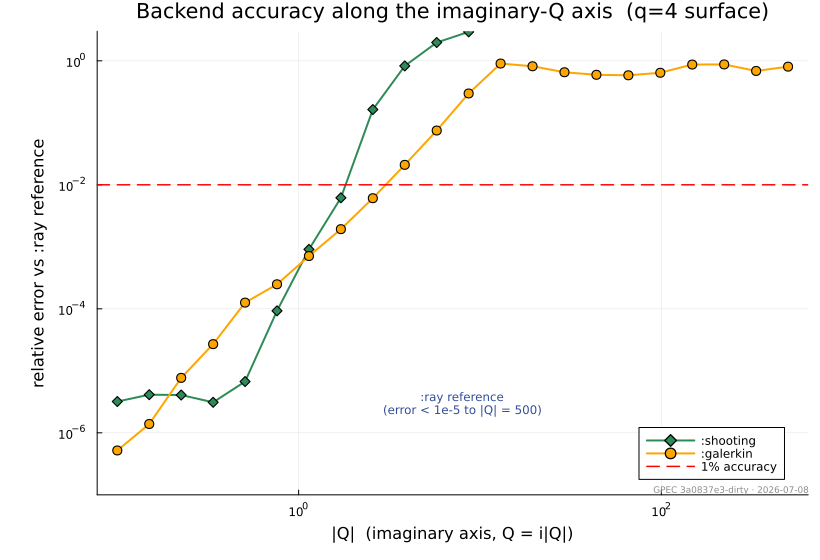
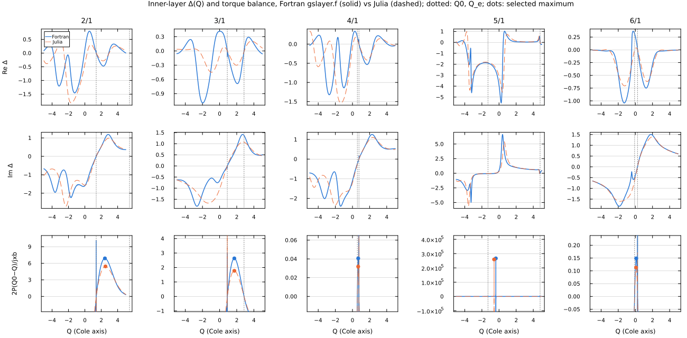

# Tearing

`Tearing` solves the resistive tearing stability of each rational surface by matching the outer-region Δ′ of the force-free states to the response of a resistive inner layer.
The outer region, ideal MHD everywhere except at the rational surfaces, gives the tearing drive Δ′; the inner layer, where resistivity, two-fluid effects and rotation act, gives the response Δ(Q) as a function of the complex mode frequency; the roots of Δ′ = Δ(Q) are the tearing modes, with their growth rates and real frequencies.

## What it computes

Two layer models are available, selected by `[Tearing] inner_model`:

- `"SLAYER"`, the two-fluid drift-MHD slab layer equations of Cole and Fitzpatrick (2006), in the form Park's SLAYER solver takes them with a few terms dropped ([Park (2022)](citations.md#Tearing), [Burgess et al. (2026)](citations.md#Tearing)), with resistivity, perpendicular and toroidal transport, diamagnetic drifts and E×B rotation taken from the kinetic profiles of the equilibrium; its options are in `[SLAYER]`.
- `"GGJ"`, the toroidal resistive-MHD layer of Glasser, Greene and Johnson ([Glasser, Wang and Park (2016)](citations.md#Tearing), [Glasser and Wang (2020)](citations.md#Tearing)), whose coefficients E, F, G, H, K are the flux-surface averages stored under `SingularSurfaces/`; its solver options are in `[GGJ]`.

For each surface the `Dispersion` search scans the complex frequency plane, extracts the roots of the dispersion relation and classifies them, and `[Tearing.search]` sets the scan.
With `[Tearing.CriticalResonantField]` the stage also computes, for the `SLAYER` layer, the resonant field at which a static error field overcomes the layer's shielding: the error-field penetration threshold.

The same GGJ layer serves the `[Match]` stage of the [Workflow](workflow.md), which does the complementary job: instead of finding the free modes it imposes the layer response on the driven force-free states and writes the matched solution to `SingularSurfaces/Match/`.

## Governing equations

The GGJ layer equations couple the perturbed flux ``\Psi`` and the layer variables ``\Xi``, ``\Upsilon`` in the scaled distance ``x`` from the rational surface (Glasser, Wang and Park (2016), Eq. 11).
A physical growth rate ``\gamma`` maps to the scaled frequency ``Q`` by [`inner_Q`](@ref InnerLayer.inner_Q), the model requires Mercier stability ``D_I < 0`` ([`mercier_di`](@ref InnerLayer.mercier_di)), and at large ``x`` the solutions contain the two power laws of the outer region.
The matching datum ``\Delta`` is the ratio of the large to the small power-law coefficient; imposing the two parities at ``x = 0`` gives the pair ``(\Delta_+, \Delta_-)``: ``\Delta_+`` even in the displacement ``\Xi``, the **interchange** channel, ``\Delta_-`` odd, the **tearing** channel.
Positional pairs are always ordered ``(\Delta_+, \Delta_-)``, and `InnerLayerResponse` names them `interchange` and `tearing`.
The dispersion relation of a surface is then ``\Delta'_s = \Delta_-(Q)`` with ``\Delta'_s`` the surface's diagonal of `SingularSurfaces/Delta_prime_matrix` converted to the layer's normalization (`PerSurface/Delta_prime_norm`); `coupling_mode = "coupled"` solves the determinant of the full matrix over up to `msing_max` surfaces instead.

The SLAYER layer is a slab with the Lundquist number ``S``, the temperature ratio ``\tau = T_i/T_e``, the compressibility ``c_\beta``, the perpendicular and toroidal Prandtl numbers ``P_\perp``, ``P_\mathrm{tor}`` and the diamagnetic frequencies ``Q_e``, ``Q_i`` of each surface (all stored under `Tearing/PerSurface/`), solved by a Riccati integration across the layer; its layer thickness ``\delta_s`` is written to `Tearing/LayerWidths/` and feeds the layer-overlap cap of [Stability](stability.md).

### Critical resonant field

With `[Tearing.CriticalResonantField]` each `SLAYER` surface gets the critical resonant field for error-field penetration, from the steady-state torque balance of Cole and Fitzpatrick (2006): the electromagnetic torque on the layer balances the viscous restoring torque when

```math
\frac{\operatorname{Im}\hat\Delta(Q)}{|\alpha + \hat\Delta(Q)|^2}
  = \frac{2P\,(Q_0 - Q)}{S\hat\kappa\,(b_r/B_\phi)^2},
\qquad
\hat\kappa = \left[\frac{2}{s}\right]^2 \int_{r_s}^{a} \frac{\mu(r_s)}{\mu(r)}\,\frac{dr}{r},
```

and balance is lost above

```math
\left(\frac{b_r}{B_\phi}\right)^2_\mathrm{crit}
  = \max_Q \frac{2P\,(Q_0 - Q)}{S\hat\kappa\,\operatorname{Im}[-1/(\alpha + \hat\Delta(Q))]} .
```

``P`` is the layer's `P_tor`, ``S`` its Lundquist number, ``Q_0 = \tau_k n \omega_E`` the natural E×B rotation of the mode (from the kinetic file's `omega_E` or the `omega_E_kHz` override, a `[Tearing]` table keyed by surface such as `omega_E_kHz = { "2/1" = 3.0 }`; a surface without one is skipped), and the viscosity integral is taken as 1/2, so ``\hat\kappa = 2/s^2``.
Each surface uses its own stability parameter ``\alpha = S^{-1/3}(\Delta_\mathrm{crit} - r_s\Delta')``, so the torque balance shares its poles with the free modes; the threshold needs a tearing-stable surface, and one with ``\alpha \le 0`` is skipped with a warning.
Penetration is the first resolved saddle-node bifurcation on the path from ``Q_0`` toward the electron fluid at ``Q_e``, above which the shielded branch no longer exists; small numerical extrema and the unshielded zone next to ``Q_e`` are excluded, and a surface without a resolved bifurcation reports NaN.
`br_crit` is normalized by the toroidal field, and `br_crit_tesla = br_crit·|B0|` is the quantity to compare with `PerturbedEquilibrium/SingularCoupling/resonant_area_weighted_field`, the total resonant field of the ideal response; the comparison is approximate, since the theory's ``b_r`` is a cylindrical field at the layer.

## Running it

From `examples/DIIID-like_SLAYER_example/gpec.toml`, after a `[ForceFreeStates]` solve with `integrator = "Riccati"` and `vac_flag = true` (or `"Galerkin"` with `rpec_flag = true`), which provides the Δ′ matrix, and with a kinetic file on the equilibrium:

```toml
[Tearing]
inner_model = "SLAYER"            # or "GGJ"
coupling_mode = "uncoupled"       # one dispersion relation per surface; "coupled" uses the full Δ′ matrix

[Tearing.search]
scan_mode = "amr"                 # adaptively refined scan of the complex Q plane
Q_re_range = [-2.0, 2.0]
Q_im_range = [-0.5, 3.0]
nre = 41
nim = 31
pole_threshold_adaptive = true
filter_above_poles = true
filter_outside_re = true
polish_roots = true
store_scan = false                # true: write Tearing/Scan/Surface_<k>/

[Tearing.CriticalResonantField]
n = 2000                          # Q samples of the torque balance
store_scan = false

[SLAYER]
D_c_type = "none"                 # critical-Δ offset from parallel transport ("none": zero)
P_perp_model = "D_perp"           # how the perpendicular Prandtl number is built (below)
```

In a script, `solve(TearingProblem(ffs; critical_resonant_field=CriticalResonantFieldControl()), SLAYERModel(); config=TearingConfig(...))` runs the same stage, and `solve_inner(GGJModel(), p, γ)` evaluates one GGJ layer at a growth rate ``\gamma``.
GGJ's η and ρ default from the kinetic data (η by the resistivity closure SLAYER uses, ρ = μ·m_p·n_e); pass `eta` and `rho` to `TearingProblem` to override them.

### SLAYER inputs: perpendicular diffusivities

The layer widths and the critical island width of `SLAYER` take perpendicular diffusivities from the kinetic file (`chi_e`, `chi_i`, `chi_phi` profiles in m²/s).
Two formulas want different quantities: the layer width goes through `P_perp`, the diffusion of the total pressure, while the critical island width ``W_d \propto (\chi_\perp/\chi_\parallel)^{1/4}`` is set by the electron heat transport that flattens the electron temperature across the island.
`[SLAYER] P_perp_model` selects how `P_perp` is built: from the perpendicular particle diffusivity ``D_\perp`` that weights the electron and ion channels by their share of the pressure gradient (`"D_perp"`, the default), from `chi_e` alone (`"chi_perp_e"`, the single-χ convention of Fitzpatrick's TJ code), from `chi_i`, from the toroidal Prandtl number, from its ``c_\beta^2`` floor, or from a whole-plasma confinement time (`"tau_E"`, for a plasma without χ profiles).
`[SLAYER] chi_perp_Dc` sets the electron diffusivity of the critical island width alone, one value for every surface, for a run in which one χ⊥,e cannot serve both formulas; where an interpretive power balance cannot separate the species, treat it as a modeling choice and scan it.
Since the widths scale as ``\chi^{1/4}``, a factor-two change in χ moves them by about 19%, which can be enough to move the resistive-layer overlap cut of [Stability](stability.md) by one surface.
The DIII-D-like kinetic file of the examples carries analytic χ profiles of the order of power-balance values for DIII-D H-modes; they are not fits to a measured discharge, do not resolve the pedestal transport barrier, and `chi_e` is raised by a factor of two so that the default deck exercises the layer-overlap cut.

## Outputs

| Dataset | Meaning |
|---|---|
| `Tearing/PerSurface/rational_psi`, `rational_q`, `m`, `n` | the analyzed surfaces |
| `Tearing/PerSurface/S`, `tau`, `c_beta`, `P_perp`, `P_tor`, `Q_e`, `Q_i`, `tau_k`, `tau_R`, `eta`, `rs`, … | the layer parameters of each surface (SLAYER); `E`, `F`, `G`, `H`, `K`, `M`, `tau_A` and `tau_R` for GGJ |
| `Tearing/PerSurface/Delta_prime_raw` and `Delta_prime_matrix_rs` (SLAYER) or `Delta_prime_matrix` (GGJ) | the outer matrix each layer was matched to |
| `Tearing/PerSurface/Delta_prime_norm`, `delta_prime_conversion` | the Δ′ normalization of the SLAYER layer |
| `Tearing/Roots/Q_root`, `omega`, `gamma`, `no_root` | the dispersion root of each surface in the lab frame (`frequency_frame` attribute), its real frequency and growth rate, and the flag of a surface with no usable root |
| `Tearing/LayerWidths/delta_s`, `delta_s_abs`, `d_beta` | the complex resistive layer thickness, its magnitude in metres, and the ion drift scale |
| `Tearing/Diagnostics/ValidRoots`, `Poles`, `FilteredRoots` | the root classification of the scan |
| `Tearing/Scan/Surface_<k>/` | the scanned Δ(Q) with `store_scan = true` |
| `Tearing/CriticalResonantField/br_crit`, `br_crit_tesla`, `Q_peak`, `Q0` | the penetration threshold as ``b_r/B_\phi`` and in tesla, the Q of the balance maximum and the natural rotation |

## Numerical notes

The `GGJ` model exposes three solvers through the `solver` type parameter of [`GGJModel`](@ref InnerLayer.GGJModel), all returning ``\Delta`` in the same convention:

| backend | method | robust regime |
|:--------|:-------|:--------------|
| `:shooting` | backward stable shoot from ``X_\mathrm{max}\to 0`` | ``\lvert Q\rvert \ll 1`` |
| `:galerkin` | Hermite-cubic finite-element solve on the real axis | surface- and ``\arg Q``-dependent; see [Choosing a backend](@ref) |
| `:ray` (default) | rotated contour: inward-marched far-field condition and a Hermite-cubic BVP | ``\lvert Q\rvert \sim 500`` on or near the imaginary axis |

`:ray` continues the layer equations analytically onto the ray ``x = e^{i\theta}s`` with ``\theta = \arg(Q)/4``, which makes the exponent of the outer solutions real and lifts the pseudo-resonance at ``x^2 = -Q^2(G + KF)`` off the contour; it takes the far-field data from the asymptotic series where its residual is below tolerance ([`pick_smax`](@ref InnerLayer.pick_smax)), marches the power pair inward by an implicit Radau scheme that damps the growing exponential directions, and solves the Hermite-cubic boundary-value problem with the parity conditions at ``s = 0``.
``\Delta`` does not depend on the contour angle, so [`delta_convergence`](@ref InnerLayer.delta_convergence) re-solves with each numerical knob perturbed and reports the spread as an error bar.



Validation: at the real operating point ``Q = 0.1234`` of Glasser and Wang (2020) the `:galerkin` backend reproduces the Fortran `rmatch` solver to ``\sim 10^{-8}`` and `:ray` agrees to ``4\times10^{-7}`` in ``\Delta_-`` (``1.3\times10^{-4}`` in ``\Delta_+``, which sits near a pole); on the ``q = 4`` benchmark surface ([`q4_surface_benchmark`](@ref InnerLayer.GGJ.q4_surface_benchmark), ``S \approx 4.6\times10^6``, ``D_I \approx -0.31``) `:ray` is pinned at ``Q = 500i`` to ``\Delta_+ = 2.4720 + 13.3540\,i``, ``\Delta_- = 0.13750 + 0.74275\,i``, with a knob-perturbation error bar of ``\sim 5\times10^{-6}`` and ``6\times10^{-7}``.
The critical-field torque balance reproduces the Fortran SLAYER's balance to all printed digits when fed the same Δ(Q) table; the thresholds differ through the layer model (Park's reduced form of the layer equations against Cole and Fitzpatrick's full ones) and the selection rule above.



### Choosing a backend

`:ray` is the default and the recommended backend for every ``Q``: it resolves the local WKB rate in every cell and holds ``\sim 2\times10^{-6}`` for ``|Q|`` from 0.01 to 1 on every surface tested.
`:galerkin` takes a few milliseconds per solve, 3–60 times less than `:ray`, but its accuracy depends on the surface and on ``\arg Q`` even at small ``|Q|``, erring by order unity near ``\arg Q = 157.5^\circ``.
The backends take disjoint numerical keywords: pass `GGJModel(solver=:galerkin)` explicitly when supplying its `nx`/`xfac` knobs.

```julia
using GeneralizedPerturbedEquilibrium.InnerLayer

p = GGJ.q4_surface_benchmark()      # GGJParameters for the q = 4 benchmark surface
γ = 500im * GGJ.q0(p)               # physical rate placing Q on the imaginary axis at 500i
Δ = solve_inner(GGJModel(), p, γ)   # Δ.interchange, Δ.tearing with the default :ray backend
```

## API reference

### Tearing

```@autodocs
Modules = [GeneralizedPerturbedEquilibrium.Tearing]
```

### InnerLayer

```@autodocs
Modules = [GeneralizedPerturbedEquilibrium.InnerLayer]
```

### GGJ

```@autodocs
Modules = [GeneralizedPerturbedEquilibrium.InnerLayer.GGJ]
```

### SLAYER

```@autodocs
Modules = [GeneralizedPerturbedEquilibrium.InnerLayer.SLAYER]
```

### Dispersion

```@autodocs
Modules = [GeneralizedPerturbedEquilibrium.Tearing.Dispersion]
```

### CriticalResonantField

```@autodocs
Modules = [GeneralizedPerturbedEquilibrium.Tearing.CriticalResonantField]
```
