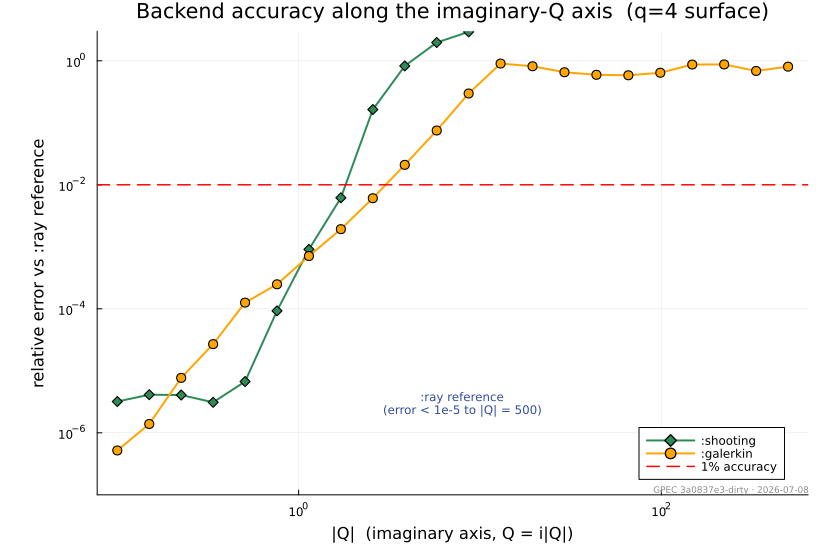
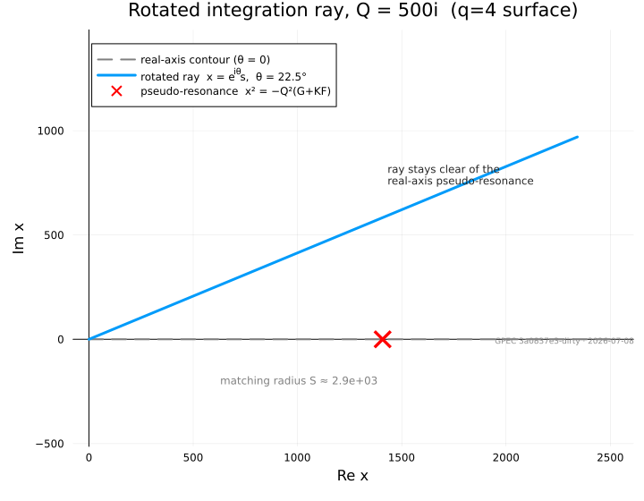
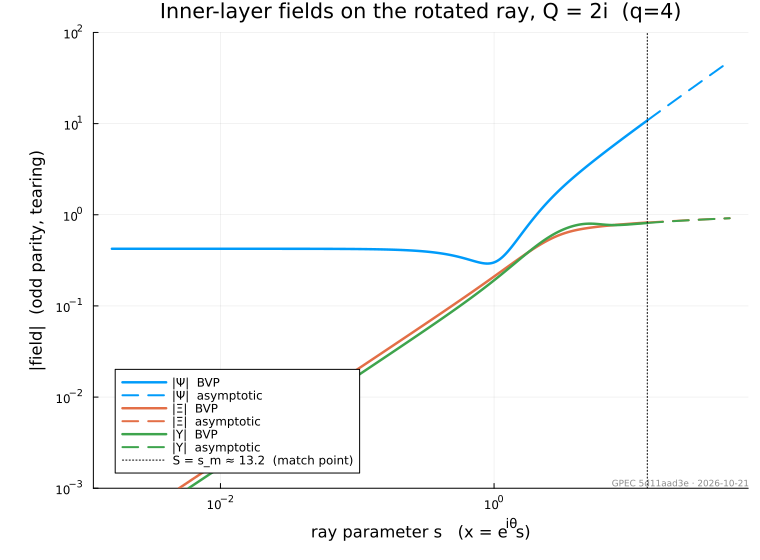
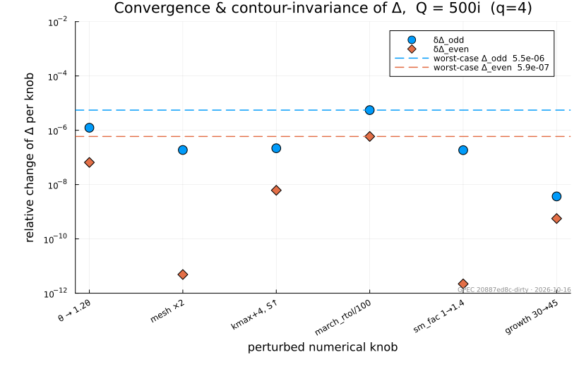
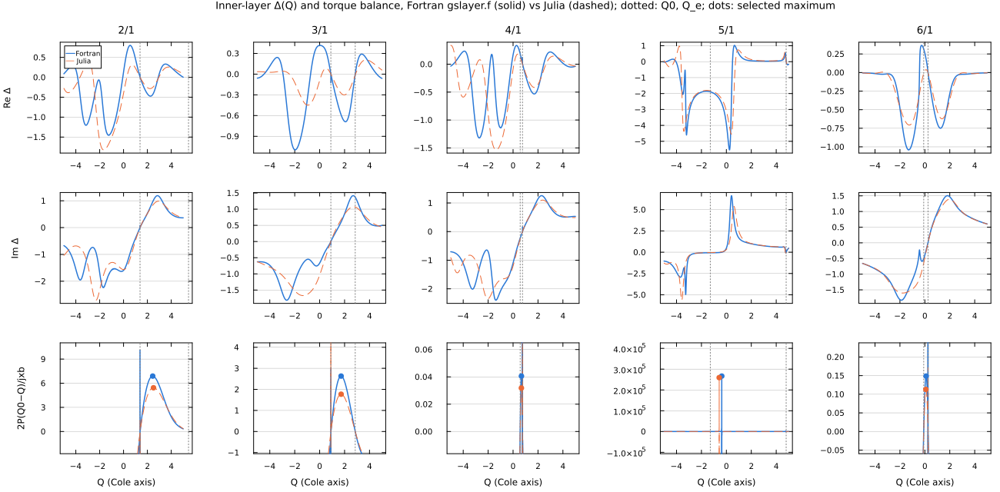

# Tearing Module

The `Tearing` module groups the resistive tearing-mode analysis stack:
`InnerLayer` (per-surface inner-layer matching data Δ(Q) for the GGJ and
SLAYER models), `Dispersion` (physics-agnostic complex-plane scan and
contour-intersection root extraction), `CriticalResonantField` (torque-balance
error-field penetration threshold), and `Runner` (user-facing TOML
configuration, profile loading, and HDF5 output).

## Layer Inputs

Equilibrium/ForceFreeStates glue that assembles per-surface inner-layer inputs.

```@autodocs
Modules = [GeneralizedPerturbedEquilibrium.Tearing]
```

The module provides an abstract [`InnerLayerModel`](@ref InnerLayer.InnerLayerModel) interface and two
concrete models: the **GGJ (Glasser–Greene–Johnson)** layer documented below, with three
interchangeable solver backends, and the pressureless **SLAYER** Fitzpatrick Riccati layer.
Further inner-layer models (kinetic layers) plug in through the same interface.

Two papers define the equations and the asymptotic construction; the code and this page cite
them by equation number rather than restating them:

- **GWP2016** — A. H. Glasser, Z. R. Wang and J.-K. Park, *Computation of
  resistive instabilities by matched asymptotic expansions*, Phys. Plasmas
  **23**, 112506 (2016).
- **GW2020** — A. H. Glasser and Z. R. Wang, *Asymptotic solutions and
  convergence studies of the resistive inner region equations*, Phys. Plasmas
  **27**, 012506 (2020).

## Equations and matching data

The GGJ layer equations (GWP2016 Eq. 11 ≡ GW2020 Eq. 1) couple the perturbed flux ``\Psi`` and
the layer variables ``\Xi``, ``\Upsilon`` in the scaled distance ``x`` from the rational surface.
Their equilibrium coefficients ``E, F, G, H, K`` (GWP2016 Eq. A8) are held in
[`GGJParameters`](@ref InnerLayer.GGJParameters). A physical growth rate ``\gamma`` maps to the
scaled ``Q`` by [`inner_Q`](@ref InnerLayer.inner_Q) (GWP2016 Eqs. A11, A14–A16), and
[`rescale_delta`](@ref InnerLayer.rescale_delta) returns the matching data to physical units. The
model requires Mercier stability, ``D_I < 0`` ([`mercier_di`](@ref InnerLayer.mercier_di),
GWP2016 Eq. A9), so that at large ``x`` the solutions include two power laws (GW2020 Eq. 49).

The matching datum ``\Delta`` is the ratio of the large to the small power-law coefficient.
Imposing the two parities at ``x = 0`` gives the pair ``(\Delta_+, \Delta_-)`` of GWP2016
Eqs. (34)–(35). Parity is that of the displacement ``\Xi`` (GWP2016 Eq. 34; Pletzer, Bondeson &
Dewar, J. Comput. Phys. **115**, 530 (1994), Eqs. 32–33): ``\Delta_+`` is even,
``\Psi(0)=\Xi'(0)=\Upsilon'(0)=0``, the **interchange** channel; ``\Delta_-`` is odd,
``\Psi'(0)=\Xi(0)=\Upsilon(0)=0``, the **tearing** channel. Positional pairs, such as `deltar` in
the matching and `RaySolveResult.Δ`, are always ordered ``(\Delta_+, \Delta_-)``, like the
unknowns ``d_\pm`` of GWP2016 Eq. (38) and Pletzer, Bondeson & Dewar Eqs. 83, 85;
`InnerLayerResponse` names them `interchange` and `tearing`.

## Numerical method

!!! note "Benchmark surface used in the figures"
    The figures use the ``q = 4`` DIII-D-like surface of
    [`q4_surface_benchmark`](@ref InnerLayer.GGJ.q4_surface_benchmark)
    (``S \approx 4.6\times10^{6}``, ``D_I \approx -0.31``).

### Solver backends

The `GGJ` model exposes three solvers through the `solver` type parameter of
[`GGJModel`](@ref InnerLayer.GGJModel); all use the same large-``x`` asymptotic basis and return
``\Delta`` in the same convention:

| backend | method | robust regime |
|:--------|:-------|:--------------|
| `:shooting` | backward stable shoot from ``X_\mathrm{max}\to 0`` | ``\lvert Q\rvert \ll 1`` |
| `:galerkin` | Hermite-cubic finite-element (real axis) | surface- and ``\arg Q``-dependent; see [Choosing a backend](@ref) |
| `:ray` (default) | rotated contour: inward-marched far-field condition + Hermite-cubic BVP | ``\lvert Q\rvert \sim 500`` on/near the imaginary axis |

Rotation and resistivity scans live on the imaginary-``Q`` axis, where the pseudo-resonance at
``x^2 = -Q^2(G+KF)`` sits on the real-``x`` path. On the ``q = 4`` surface there `:shooting` and
`:galerkin` lose accuracy beyond ``|Q| \sim 1`` and ``|Q| \sim 4`` respectively (the poles of ``\Delta(Q)``
themselves lie near the real-``Q`` axis):



### The rotated ray

`:ray` writes the layer equations as ``dv/dx = M(x)\,v`` in the plain state
``v = (\Psi, \Xi, \Upsilon, \Psi', \Xi', \Upsilon')``. ``M`` is polynomial in ``x``, so
``x = 0`` is an ordinary point and the system continues analytically onto the ray

```math
x = e^{i\theta}\, s, \qquad s \in [0, S], \qquad \theta = \tfrac14\arg Q .
```

This angle makes the parabolic-cylinder exponent of the outer solutions real and lifts the
pseudo-resonance off the contour; ``\theta = 0`` is a real-axis solve.



### Hermite-Galerkin BVP

On ``[0, s_m]`` the system is solved with the `:galerkin` backend's Hermite-cubic assembly
(GWP2016 Eq. 32) written on the ray, ``A u_{ss} + e^{i\theta}B u_s + e^{2i\theta}C u = 0``,
with the parity conditions at ``s = 0``. The far end carries the point condition

```math
v(s_m) = U_s + \Delta\, U_b + c_1 E_1 + c_2 E_2 ,
```

where ``U_s, U_b`` are the small and large power-like solutions and ``E_{1,2}`` the
forward-decaying exponential pair; ``\Delta, c_1, c_2`` replace the last node's six unknowns.
Each cell resolves the local WKB rate, with a minimum cell count for small ``|Q|``.

### Far-field boundary and the inward march

The boundary data come from the same `inps` Wasow basis as the other backends (GW2020
Eqs. 3–53), evaluated at the radius ``S`` where its residual is below tolerance
([`pick_smax`](@ref InnerLayer.pick_smax)). At large ``|Q|``, ``S`` lies far beyond ``s_m``, and
the power pair is marched inward by 2-stage Radau IIA modulo the decaying pair, the subspace in
which ``\Delta`` is defined. The decaying pair grows under backward integration at a rate
``\sim\rho s``. Radau's stability function decays as ``2/z``, so steps with every growing mode at
``z > 8`` damp those directions while the slowly varying power pair stays resolved; the step count
grows only like ``\ln(S/s_m)``. Nearer ``s_m`` the march resolves the growing directions, carries
the decaying frame, and projects it out periodically. The damped zone runs in `Complex{Double64}`
because its ill-conditioned implicit solves mix the power pair at a level ``\sim\epsilon\rho S^2``.

On the real axis with imaginary ``Q`` the switch to resolved steps lands on the
pseudo-resonance, a turning point where the decaying directions cannot be identified; the
default ``\theta = \arg(Q)/4`` keeps it off the contour.

For matching, `solve_inner_profile` returns ``\Delta`` and the layer-center fields
``\Psi(0), \Xi(0)`` from the rotated solve; ``x = 0`` lies on every contour, so these are the
real-axis values. Fields across the layer on the real ``\psi`` axis are an opt-in diagnostic
(`GGJModel(; real_profiles=true)`, not exposed in the deck): they come from an extra ``\theta = 0``
solve, while the ``x = 0`` values, and so the penetrated field, stay those of the rotated solve.
The ``\theta = 0`` solve's ``\Delta_\pm`` are checked against the rotated ones (`certΔ`, which
warns on disagreement, as can happen at large ``|Q|`` near the imaginary axis).



## Validation and benchmarks

**Cross-check against the Fortran `rmatch` solver.** At the Glasser & Wang
(2020) Eq. (55) operating point ``Q = 0.1234`` (real) the `:galerkin` backend
reproduces the Fortran `rmatch deltac` solver to ``\sim 10^{-8}``:

| quantity | `:galerkin` (= Fortran to ``10^{-8}``) | `:ray` |
|:---------|:---------------------------------------|:-------|
| ``\Delta_+`` (interchange) | ``3.698368\times 10^{4}`` | ``3.69789\times 10^{4}`` |
| ``\Delta_-`` (tearing) | ``14.759721`` | ``14.759715`` |

This point sits near a pole of ``\Delta_+(Q)``, which amplifies every solver's error; hence the
``1.3\times10^{-4}`` `:galerkin`↔`:ray` difference in ``\Delta_+`` against ``4\times10^{-7}`` in ``\Delta_-``.

**Physical benchmark on the imaginary axis.** On the ``q=4`` rational-surface
benchmark ([`q4_surface_benchmark`](@ref InnerLayer.GGJ.q4_surface_benchmark), ``S \approx 4.58\times10^6``,
``D_I \approx -0.312``) the `:ray` backend is pinned at ``Q = 500i``, a regime
entirely beyond `:galerkin`:

| quantity | value at ``Q = 500i`` |
|:---------|:----------------------|
| ``\Delta_+`` (interchange) | ``2.4720 + 13.3540\,i`` |
| ``\Delta_-`` (tearing) | ``0.13750 + 0.74275\,i`` |

**Convergence and contour invariance.** ``\Delta`` does not depend on the contour angle, so
re-solving with each numerical knob perturbed in turn
([`delta_convergence`](@ref InnerLayer.delta_convergence)) gives an error bar: at ``Q = 500i`` the
worst case is ``\sim 5\times10^{-6}`` for ``\Delta_+`` and ``\sim 6\times10^{-7}`` for ``\Delta_-``.
Across machines and BLAS builds the values reproduce to ``\sim 10^{-5}`` relative, hence the five
significant figures above.



## Choosing a backend

`:ray` is the **default** — `GGJModel()` constructs `GGJModel{:ray}()` — and the recommended
backend for every ``Q``. It uses the same Hermite-cubic weak form as `:galerkin`; they differ in
where and how the far-field condition is imposed. `:galerkin` imposes it on the real axis through
resonant and extension cells at the radius where the series residual reaches ``10^{-7}``, on a
fixed `nx`-cell grid. `:ray` takes the series data where the residual reaches `smax_tol` =
``10^{-9}`` ([`pick_smax`](@ref InnerLayer.pick_smax)), marches them inward to ``s_m``, where every
exponential family has decayed 45 e-folds from the origin, and resolves the local WKB rate in
every cell on ``[0, s_m]``. Both radii are computed per solve; `S`, `smax_tol` and `sm_fac`
override them, and [`delta_convergence`](@ref InnerLayer.delta_convergence) perturbs them to give
an error bar.

`:galerkin` takes a few milliseconds per solve, 3–60 times less than `:ray`, but its accuracy
depends on the surface and on ``\arg Q`` even at small ``|Q|``. Against a tightened `:ray`
reference, on the GW2020 Eq. (55) surface it errs by ``7\times10^{-5}`` at ``Q = 0.1`` and
``3\times10^{-3}`` at ``Q = 0.3``; near ``\arg Q = 157.5^\circ`` it errs by order unity at
``|Q| = 0.1`` on that surface and by 0.4 at ``|Q| = 0.3`` on the ``q = 4`` surface. `:ray` held
``2\times10^{-6}`` on all three surfaces tested, for ``|Q|`` from 0.01 to 1.

The backends take disjoint numerical-knob keywords: pass `GGJModel(solver=:galerkin)` explicitly
when supplying the Galerkin `nx`/`xfac` knobs; passing them to `:ray` throws a `MethodError`.

```julia
using GeneralizedPerturbedEquilibrium.InnerLayer

p = GGJ.q4_surface_benchmark()      # GGJParameters for the q=4 benchmark surface
γ = 500im * GGJ.q0(p)               # physical rate placing Q on the imaginary axis at 500i

Δ = solve_inner(GGJModel(), p, γ)   # Δ.interchange, Δ.tearing with the default :ray backend

# Full result (raw Δ, contour, mesh, nodal solution, boundary conditioning) via solve_ray:
res = solve_ray(p, GGJ.inner_Q(p, γ))
res.Δ, res.breaks, res.bc_cond      # res.Δ = (Δ₊, Δ₋) = (interchange, tearing)
```

## Critical resonant field

With `[SLAYER.CriticalResonantField] enabled = true`, each SLAYER surface also gets the
critical resonant field for error-field penetration, from the steady-state torque balance of
Cole and Fitzpatrick, Phys. Plasmas **13**, 032503 (2006). The electromagnetic torque on the
layer balances the viscous restoring torque when (Cole Eq. 61)

```math
\frac{\operatorname{Im}\hat\Delta(Q)}{|\alpha + \hat\Delta(Q)|^2}
  = \frac{2P\,(Q_0 - Q)}{S\hat\kappa\,(b_r/B_\phi)^2},
\qquad
\hat\kappa = \left[\frac{2}{s}\right]^2 \int_{r_s}^{a} \frac{\mu(r_s)}{\mu(r)}\,\frac{dr}{r},
```

and balance is lost above (Cole Eq. 62)

```math
\left(\frac{b_r}{B_\phi}\right)^2_\mathrm{crit}
  = \max_Q \frac{2P\,(Q_0 - Q)}{S\hat\kappa\,\operatorname{Im}[-1/(\alpha + \hat\Delta(Q))]} .
```

- **Inputs.** P is each layer's `P_tor` (so χ_φ from the kinetic file, or the scalar
  `chi_tor`), S its Lundquist number, and Q0 = τ_k·n·ω_E the natural E×B rotation of the
  m/n mode (Cole's ω0; the diamagnetic drifts enter through Q_e and Q_i in Δ̂). Ω_E is the
  kinetic file's `omega_E` or the `omega_E_kHz` override; the analysis needs it, and a surface
  without one is skipped.
- **Approximations.** As in Fortran `gslayer.f`, the viscosity integral is taken as 1/2
  (κ̂ = 2/s²).
- **Outer stability α.** Each surface uses its own α = S^(−1/3)(Δ_crit − r_s Δ'), the same
  outer stability the dispersion relation uses (Fortran fixes α = 10⁻²). Cole's threshold needs
  a tearing-stable surface, so a surface with α ≤ 0 is skipped with a warning.
- **Q axis.** Q is on Cole's axis, with the diamagnetic poles at Q_e and Q_i; `solve_inner`
  mirrors the real axis, so the scan uses conj(Δ(−Q)).
- **Threshold.** Penetration is a fold (Fitzpatrick, Nucl. Fusion 33, 1049 (1993), Sec. 7.4):
  as the field grows, Q moves from Q0 toward the electron fluid at Q_e, where the torque
  vanishes, and the threshold is the largest balance on that path, above which no shielded steady
  state remains; the balance must drop by more than 0.1 % after it, which keeps sampling noise
  from counting as a fold. Points where |Δ̂| ≤ α, the unshielded zone next to Q_e, are not
  candidates, so the balance spike there is never taken. With no fold the rotation slows
  smoothly and no discrete threshold is reported (NaN). Fortran takes the global maximum on a
  window instead, which picks that spike. The search assumes Q_i ≤ 0 ≤ Q_e; a surface where
  that fails is skipped with a warning.

Outputs go to `Tearing/CriticalResonantField/` (`br_crit` = b_r/B_φ, `Q_peak`, `Q0`, with P in
`PerSurface/P_tor`, and with `store_scan` the per-surface `Scan/Surface_<k>/{Q, balance, Delta}`).

### Benchmark against Fortran

On the DIII-D-like example (2/1–6/1, n = 1, P = 1, κ̂ = 2/s², Q ∈ [−5, 5] with 20001
points), both codes were given Fortran's normalized inputs.

- **Torque-balance routine.** Fed Fortran's own Δ(Q) table with the pole exclusion narrowed to
  one grid step, the Julia routine reproduces Fortran's b_crit and Q_peak to all printed digits
  on every surface.
- **Pole handling.** Fortran's global maximum sits within 0.003 of the Q_e pole on 2/1, 3/1,
  4/1 and 6/1. Skipping the pole region moves the threshold to the torque-balance maximum
  between Q_e and Q0 (blue dots below), lowering the Fortran-table b_crit by 6–88 %.
- **Layer model.** Fortran solves Park's drift-MHD layer and Julia Fitzpatrick's, so Δ(Q)
  differs by a median 24–78 % between Q_i and Q_e on 2/1, 3/1, 4/1 and 6/1 (7 % on 5/1), and
  Julia's b_crit is 82–89 % of the Fortran-table value on those four surfaces. The 5/1 edge surface is dominated by a
  zero of the electromagnetic torque in both codes and is not a usable threshold.



## API Reference

### InnerLayer

```@autodocs
Modules = [GeneralizedPerturbedEquilibrium.InnerLayer]
```

### GGJ

```@autodocs
Modules = [GeneralizedPerturbedEquilibrium.InnerLayer.GGJ]
```

## SLAYER

```@autodocs
Modules = [GeneralizedPerturbedEquilibrium.InnerLayer.SLAYER]
```

## Dispersion

```@autodocs
Modules = [GeneralizedPerturbedEquilibrium.Dispersion]
```

## CriticalResonantField

```@autodocs
Modules = [GeneralizedPerturbedEquilibrium.Tearing.CriticalResonantField]
```

## Runner

```@autodocs
Modules = [GeneralizedPerturbedEquilibrium.Runner]
```
